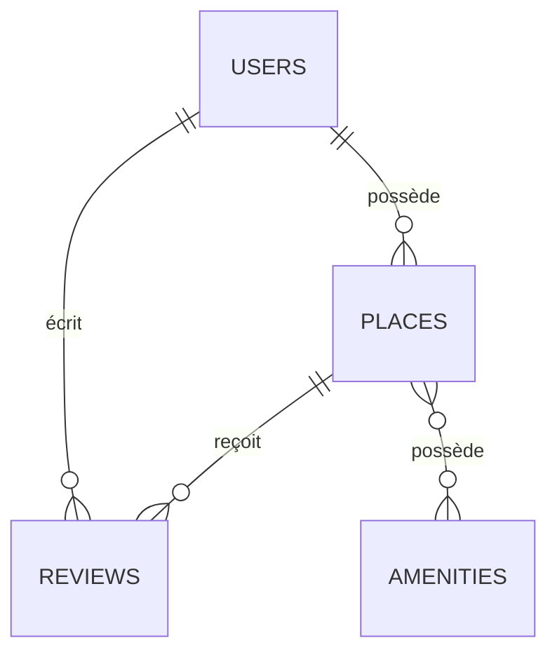

# 📚 INDEX - DOSSIER PREUVE BDD RELATIONNELLE RNCP

## 🎯 Organisation du dossier de certification

Ce dossier contient **toutes les preuves nécessaires** pour démontrer la compétence "Concevoir et implémenter une base de données relationnelle" dans le cadre de la certification RNCP.

---

## 📄 DOCUMENTS CRÉÉS POUR LA CERTIFICATION

### 1. 📘 Document principal (COMPLET)
**Fichier :** [`PREUVE_BDD_RNCP.md`](PREUVE_BDD_RNCP.md)

**Contenu :**
- ✅ Schéma Conceptuel de Données (MCD) avec diagramme ASCII
- ✅ Schéma Physique de Données (MLD) avec toutes les contraintes
- ✅ Script SQL complet (copie du fichier source)
- ✅ Détail exhaustif des 5 tables (PK/FK/UNIQUE/CHECK)
- ✅ Stratégie de jeux d'essai et tests
- ✅ Conformité REAC RNCP

**📊 Taille :** Document complet (~25 pages)
**🎯 Usage :** À soumettre au jury RNCP + support de soutenance

---

### 2. 📋 Guide de soutenance
**Fichier :** [`RECAPITULATIF_JURY_RNCP.md`](RECAPITULATIF_JURY_RNCP.md)

**Contenu :**
- Résumé exécutif du projet
- Points clés à mentionner en soutenance
- Réponses préparées aux questions probables du jury
- Checklist finale avant la soutenance
- Commandes pour démo rapide (optionnel)

**📊 Taille :** Document de préparation (~10 pages)
**🎯 Usage :** Préparation personnelle + antisèche jour J

---

### 3. 🎯 Fiche synthèse rapide
**Fichier :** [`FICHE_SYNTHESE_BDD_RNCP.md`](FICHE_SYNTHESE_BDD_RNCP.md)

**Contenu :**
- Vue d'ensemble ultra-condensée (1-2 pages)
- Toutes les tables avec contraintes (format compact)
- Chiffres clés du projet
- Réponses éclair aux questions du jury

**📊 Taille :** Fiche de révision (2 pages)
**🎯 Usage :** Référence rapide pendant la soutenance

---

### 4. 📜 Script SQL source
**Fichier :** `part3/schema.sql` OU `part4/schema.sql`

**Contenu :**
- Script SQL complet et fonctionnel
- CREATE TABLE avec toutes les contraintes
- Seed data (admin + amenities)
- Commentaires explicatifs

**📊 Taille :** ~80 lignes SQL
**🎯 Usage :** Fichier source technique (à joindre ou copier dans le document principal)

---

## 🗂️ QUELLE VERSION PRÉSENTER ?

### Option A : Dossier complet (recommandé pour le jury)
```
📦 Dossier à remettre :
├── PREUVE_BDD_RNCP.md          ← Document principal
├── part3/schema.sql             ← Script SQL original
└── schéma visuel (optionnel)    ← PNG/PDF du diagramme Mermaid
```

### Option B : Version ultra-compacte
```
📦 Dossier minimal :
└── PREUVE_BDD_RNCP.md          ← Tout est dedans (MCD+MLD+SQL)
```

### Option C : Pack complet (si demandé par le jury)
```
📦 Dossier exhaustif :
├── INDEX_DOSSIER_BDD_RNCP.md   ← Ce fichier
├── PREUVE_BDD_RNCP.md          ← Document principal
├── RECAPITULATIF_JURY_RNCP.md  ← Guide soutenance
├── FICHE_SYNTHESE_BDD_RNCP.md  ← Référence rapide
└── part3/schema.sql             ← Script SQL
```

---

## 🎬 ORDRE DE LECTURE RECOMMANDÉ

### Pour la préparation de la soutenance :
1. **[`FICHE_SYNTHESE_BDD_RNCP.md`](FICHE_SYNTHESE_BDD_RNCP.md)** - Vue d'ensemble rapide
2. **[`PREUVE_BDD_RNCP.md`](PREUVE_BDD_RNCP.md)** - Approfondir les détails techniques
3. **[`RECAPITULATIF_JURY_RNCP.md`](RECAPITULATIF_JURY_RNCP.md)** - Préparer les réponses du jury

### Pour le jury RNCP :
1. **[`PREUVE_BDD_RNCP.md`](PREUVE_BDD_RNCP.md)** - Document principal à soumettre
2. **`part3/schema.sql`** - Fichier source (annexe)

---

## 🔍 CONTENU PAR TYPE D'INFORMATION

| Information recherchée | Document principal | Documents secondaires |
|------------------------|--------------------|-----------------------|
| **MCD (schéma conceptuel)** | PREUVE_BDD_RNCP.md - Section 1 | FICHE_SYNTHESE - Relations |
| **MLD (schéma physique)** | PREUVE_BDD_RNCP.md - Section 2 | FICHE_SYNTHESE - Tables |
| **Script SQL** | PREUVE_BDD_RNCP.md - Section 3 | part3/schema.sql |
| **Détail contraintes** | PREUVE_BDD_RNCP.md - Section 4 | FICHE_SYNTHESE |
| **Jeux d'essai** | PREUVE_BDD_RNCP.md - Section 5 | - |
| **Préparation soutenance** | RECAPITULATIF_JURY_RNCP.md | FICHE_SYNTHESE |
| **Réponses rapides** | FICHE_SYNTHESE | RECAPITULATIF - Points clés |

---

## 📊 STATISTIQUES PROJET HBnB

| Métrique | Valeur | Détails |
|----------|--------|---------|
| **Tables** | 5 | users, places, reviews, amenities, place_amenity |
| **Clés primaires** | 5 | Toutes en UUID (36 chars) |
| **Clés étrangères** | 5 | Avec CASCADE sur DELETE |
| **Relations 1:N** | 3 | user→places, user→reviews, place→reviews |
| **Relations N:M** | 1 | place↔amenities |
| **Contraintes UNIQUE** | 3 | email, amenity name, (user,place) |
| **Contraintes CHECK** | 2 | price ≥ 0, rating ∈ [1,5] |
| **Seed data** | 4 entrées | 1 admin + 3 amenities |

---

## ✅ CHECKLIST CONFORMITÉ REAC

| Exigence REAC | Document | Section |
|---------------|----------|---------|
| Concevoir schéma conceptuel | ✅ PREUVE_BDD_RNCP.md | Section 1 (MCD) |
| Modéliser schéma physique | ✅ PREUVE_BDD_RNCP.md | Section 2 (MLD) |
| Écrire scripts SQL | ✅ part3/schema.sql | Fichier complet |
| Définir contraintes intégrité | ✅ PREUVE_BDD_RNCP.md | Section 4 (détail tables) |
| Créer jeux d'essai | ✅ PREUVE_BDD_RNCP.md | Section 5 (tests) |
| Documenter choix techniques | ✅ RECAPITULATIF_JURY_RNCP.md | Points à mentionner |

---

## 🎨 SCHÉMA VISUEL (OPTIONNEL)

Un schéma Mermaid a été généré et peut être exporté en PNG/PDF :



**Comment l'exporter :**
1. **VS Code** : Installer extension "Markdown Preview Mermaid Support"
2. **En ligne** : Copier dans [https://mermaid.live/](https://mermaid.live/) → Export PNG
3. **CLI** : `mmdc -i diagram.mmd -o schema.png`

---

## 🚀 DÉMO RAPIDE (SI DEMANDÉE PAR LE JURY)

### Créer la base de données
```bash
cd part3
sqlite3 instance/development.db < schema.sql
```

### Vérifier les tables
```bash
sqlite3 instance/development.db ".tables"
# Output: amenities  place_amenity  places  reviews  users
```

### Afficher le schéma d'une table
```bash
sqlite3 instance/development.db ".schema reviews"
```

### Tester une contrainte CHECK
```bash
sqlite3 instance/development.db "
INSERT INTO reviews (id, text, rating, user_id, place_id)
VALUES ('test-id', 'Excellent place', 10, 'user-id', 'place-id');
"
# → Erreur attendue : CHECK constraint failed: rating BETWEEN 1 AND 5 ✅
```

---

## 📞 INFORMATIONS PROJET

| Élément | Valeur |
|---------|--------|
| **Nom du projet** | HBnB (HolbertonBnB) |
| **Type** | Plateforme de location de logements (type Airbnb) |
| **Technologies** | Python, Flask, SQLite, SQLAlchemy |
| **SGBD** | SQLite (dev) → PostgreSQL/MySQL (prod) |
| **Architecture** | 3-tiers (API REST + Services + Persistence) |
| **Sécurité** | Bcrypt pour passwords, UUID pour IDs |
| **Date** | Février 2026 |

---

## 🎯 RÉSUMÉ EN 30 SECONDES

> **"HBnB est une plateforme de location de logements avec 5 tables relationnelles (users, places, reviews, amenities + table d'association). J'ai implémenté toutes les contraintes d'intégrité (5 FK avec CASCADE, 3 UNIQUE, 2 CHECK) et créé un script SQL complet avec données de seed. Le projet démontre la maîtrise complète de la conception MCD/MLD et l'implémentation SQL conforme au REAC."**

---

## 📚 RESSOURCES COMPLÉMENTAIRES

### Dans ce repository :
- **Documentation API** : `part3/README.md`
- **Tests unitaires** : `part3/tests/`
- **Modèles SQLAlchemy** : `part3/hbnb/app/models/`
- **Repositories** : `part3/hbnb/app/persistence/`

### Diagrammes UML (Part 1) :
- **Package Diagram** : `part1/0_Package_Diagram.md`
- **Class Diagram** : `part1/1_Class_Diagram.md`
- **Sequence Diagrams** : `part1/2_Sequence_Diagrams.md`

---

## 🎤 PHRASE D'ACCROCHE POUR LA SOUTENANCE

*"Pour ce projet, j'ai conçu et implémenté une base de données relationnelle complète pour une plateforme de location. Le schéma comprend 5 tables avec 5 clés étrangères, 3 contraintes d'unicité et 2 contraintes de vérification. J'ai particulièrement soigné l'intégrité référentielle avec des CASCADE sur les suppressions, et j'ai géré une relation many-to-many pour les équipements des logements. Le tout est testable avec un jeu de données de seed intégré au script SQL."*

---

**📁 Ce dossier est prêt pour la certification RNCP**
**Date de création : Février 2026**
**Projet : HBnB - HolbertonBnB**

---

## 🆘 AIDE RAPIDE

**❓ "Je ne sais pas quel fichier présenter au jury"**
→ Présentez **`PREUVE_BDD_RNCP.md`** + **`part3/schema.sql`**

**❓ "Je veux réviser rapidement avant la soutenance"**
→ Lisez **`FICHE_SYNTHESE_BDD_RNCP.md`** (2 pages)

**❓ "Le jury demande une démo"**
→ Suivez les commandes dans **`RECAPITULATIF_JURY_RNCP.md`** - Section "Démo rapide"

**❓ "On me demande le nombre de contraintes"**
→ **5 FK + 3 UNIQUE + 2 CHECK = 10 contraintes totales**

**❓ "Je dois expliquer une relation N:M"**
→ Table **`place_amenity`** avec PK composite (place_id, amenity_id)

---

**✅ Tous les documents sont prêts. Bonne soutenance ! 🚀**
