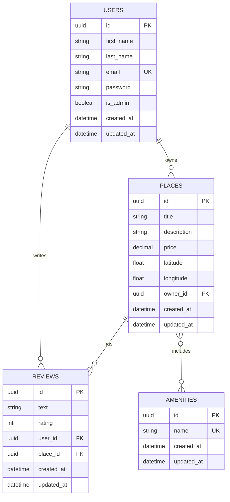

# 🏠 HBnB Evolution – Part 4: Full-Stack Application avec Frontend Complet

## 📋 Vue d'ensemble

**HBnB Evolution** est une application web full-stack complète de type **Airbnb**, développée pour répondre aux exigences du **RNCP 5 (Développeur Web et Web Mobile - Référentiel RC 37674)**.

Cette application démontre la maîtrise complète des **Blocs 1 et 2** du référentiel :
- **Bloc 1** : Développer la partie front-end d'une application web sécurisée
- **Bloc 2** : Développer la partie back-end d'une application web sécurisée

---

## 🎯 Objectifs RNCP 5 couverts

### ✅ Bloc 1 – Développement Front-End

#### Compétence 1.1 : Installer et configurer l'environnement de travail
- ✅ Environnement structuré avec VSCode, Git/GitHub
- ✅ Organisation des assets (HTML/CSS/JS) avec structure claire
- ✅ Utilisation de serveur de développement Flask pour servir le frontend

#### Compétence 1.2 : Maquetter une interface utilisateur web
- ✅ Conception basée sur benchmark (interfaces type Airbnb)
- ✅ Organisation réfléchie des informations (liste places, détails, reviews)
- ✅ Itération dans le navigateur avec DevTools

#### Compétence 1.3 : Réaliser des interfaces utilisateur statiques
- ✅ Structure HTML5 sémantique (`<header>`, `<main>`, `<section>`, `<footer>`)
- ✅ Mise en forme CSS3 complète avec Flexbox
- ✅ Palette de couleurs cohérente
- ✅ Création de composants réutilisables (cards, forms, buttons)

#### Compétence 1.4 : Développer la partie dynamique des interfaces
- ✅ JavaScript vanilla avec `fetch()` pour consommer l'API REST
- ✅ Manipulation du DOM (création dynamique de contenus)
- ✅ Gestion des événements (submit, click, change)
- ✅ Extraction de paramètres d'URL (`URLSearchParams`)
- ✅ Rafraîchissement dynamique des données

#### Compétence 1.5 : Accessibilité et responsive design
- ✅ HTML sémantique pour accessibilité
- ✅ Media queries pour adaptation mobile
- ✅ Contraste et lisibilité
- ✅ Formulaires accessibles avec labels explicites

---

### ✅ Bloc 2 – Développement Back-End

#### Compétence 2.1 : Mettre en place une structure de données
- ✅ Modèles ORM SQLAlchemy : `User`, `Place`, `Review`, `Amenity`
- ✅ Relations établies :
  - `User` 1-N `Place` (owner)
  - `User` 1-N `Review`
  - `Place` 1-N `Review`
  - `Place` N-N `Amenity` (table d'association)
- ✅ Contrainte unique : 1 review par utilisateur par place (`UNIQUE (user_id, place_id)`)

#### Compétence 2.2 : Développer des composants d'accès aux données
- ✅ Pattern Repository avec SQLAlchemy
- ✅ Repositories spécialisés : `UserRepository`, `PlaceRepository`, `ReviewRepository`, `AmenityRepository`
- ✅ Méthodes CRUD complètes (Create, Read, Update, Delete)

#### Compétence 2.3 : Développer la partie back-end d'une application web
- ✅ API REST Flask / Flask-RESTX
- ✅ Endpoints structurés :
  - `/api/v1/auth/login` (authentification)
  - `/api/v1/users/` (gestion utilisateurs)
  - `/api/v1/places/` (gestion des places)
  - `/api/v1/reviews/` (gestion des reviews)
  - `/api/v1/amenities/` (gestion des amenities)
- ✅ Validation des données d'entrée
- ✅ Gestion des erreurs HTTP (400, 401, 403, 404, 500)
- ✅ Documentation Swagger auto-générée

#### Compétence 2.4 : Mettre en œuvre la sécurité
- ✅ **Authentification JWT** (Flask-JWT-Extended)
- ✅ **Hachage des mots de passe** (Bcrypt)
- ✅ **Protection des endpoints sensibles** :
  - Création de place → utilisateur connecté uniquement
  - Création de review → utilisateur connecté uniquement
  - Mise à jour de place → owner uniquement
  - Mise à jour/suppression de review → auteur uniquement
  - Liste des utilisateurs → admin uniquement
- ✅ **Validation métier** :
  - Un utilisateur ne peut pas reviewer sa propre place
  - Un utilisateur ne peut laisser qu'une seule review par place
  - L'owner_id est extrait du JWT (pas du payload front)
- ✅ **Gestion des secrets** : fichier `.env` pour clés sensibles

#### Compétence 2.5 : Documenter le déploiement
- ✅ README complet avec instructions d'installation
- ✅ Prérequis détaillés
- ✅ Configuration de l'environnement
- ✅ Commandes de démarrage

---

## 🏗️ Architecture du Projet

```
part4/
├── app/
│   ├── __init__.py                 # Factory Flask + extensions
│   ├── extensions.py               # SQLAlchemy, Bcrypt, JWT
│   ├── api/
│   │   └── v1/
│   │       ├── auth.py             # Endpoint login JWT
│   │       ├── users.py            # CRUD Users + protection admin
│   │       ├── places.py           # CRUD Places + protection owner
│   │       ├── reviews.py          # CRUD Reviews + contrainte unicité
│   │       └── amenities.py        # CRUD Amenities
│   ├── models/
│   │   ├── base_model.py           # Classe de base (id, timestamps)
│   │   ├── user.py                 # Modèle User (hash password)
│   │   ├── place.py                # Modèle Place + relations
│   │   ├── review.py               # Modèle Review + validation rating
│   │   └── amenity.py              # Modèle Amenity
│   ├── persistence/
│   │   ├── repository.py           # Repository de base SQLAlchemy
│   │   ├── user_repository.py
│   │   ├── place_repository.py
│   │   ├── review_repository.py
│   │   └── amenity_repository.py
│   └── services/
│       └── facade.py               # Facade Pattern (business logic)
├── instance/                        # Base de données SQLite (auto-créée)
├── images/                          # Assets logo, icônes
├── index.html                       # Page liste des places
├── place.html                       # Page détails d'une place
├── add_review.html                  # Page d'ajout de review (standalone)
├── login.html                       # Page de connexion
├── styles.css                       # Styles globaux
├── scripts.js                       # Logique front-end complète
├── schema.sql                       # Schéma SQL de référence
├── config.py                        # Configuration Flask
├── run.py                           # Point d'entrée de l'application
├── requirements.txt                 # Dépendances Python
└── README.md                        # Ce fichier
```

---

## 🚀 Installation et Déploiement

### Prérequis

- **Python 3.10+**
- **pip** (gestionnaire de paquets Python)
- **Git** pour cloner le repository
- **Navigateur web moderne** (Chrome, Firefox, Edge)

### Étape 1 : Cloner le repository

```bash
git clone https://github.com/<votre-username>/holbertonschool-hbnb.git
cd holbertonschool-hbnb/part4
```

### Étape 2 : Créer un environnement virtuel

```bash
python3 -m venv venv
source venv/bin/activate  # Sur Windows: venv\Scripts\activate
```

### Étape 3 : Installer les dépendances

```bash
pip install -r requirements.txt
```

**Contenu de `requirements.txt` :**
```
flask
flask-restx
flask-sqlalchemy
flask-bcrypt
flask-jwt-extended
flask-cors
python-dotenv
```

### Étape 4 : Configurer l'environnement

Créez un fichier `.env` à la racine de `part4/` :

```bash
SECRET_KEY=votre-cle-secrete-tres-longue-et-aleatoire
JWT_SECRET_KEY=votre-cle-jwt-secrete-differente
DATABASE_URL=sqlite:///instance/hbnb.db
```

**Génération de clés sécurisées :**
```bash
python3 -c "import secrets; print(secrets.token_hex(32))"
```

### Étape 5 : Initialiser la base de données

```bash
python3 -c "from app import create_app; from app.extensions import db; app = create_app(); app.app_context().push(); db.create_all(); print('Database initialized!')"
```

### Étape 6 : Créer un utilisateur admin (optionnel)

```python
from app import create_app, bcrypt
from app.extensions import db
from app.models.user import User

app = create_app()
app.app_context().push()

admin = User(
    first_name="Admin",
    last_name="HBnB",
    email="admin@hbnb.com",
    password="Admin123!",
    is_admin=True
)
db.session.add(admin)
db.session.commit()
print(f"Admin created: {admin.email}")
```

### Étape 7 : Lancer l'application

```bash
python run.py
```

L'application démarre sur **http://localhost:5000**

---

## 🌐 Utilisation de l'application

### 📄 Pages Frontend

#### 1. **Page d'accueil** (`index.html`)
- URL : `http://localhost:5000/index.html`
- **Fonctionnalités** :
  - Liste dynamique de toutes les places disponibles
  - Filtre par prix maximum
  - Bouton "View Details" pour voir les détails d'une place
  - Affichage du bouton "Login" si non connecté

#### 2. **Page de connexion** (`login.html`)
- URL : `http://localhost:5000/login.html`
- **Fonctionnalités** :
  - Formulaire de connexion (email + password)
  - Authentification via JWT
  - Redirection vers la page d'accueil après succès
  - Stockage du token JWT dans les cookies

#### 3. **Page détails d'une place** (`place.html`)
- URL : `http://localhost:5000/place.html?id=<place_id>`
- **Fonctionnalités** :
  - Affichage des détails complets de la place
  - Liste des amenities
  - Affichage des reviews avec système d'étoiles
  - **Formulaire d'ajout de review** (visible uniquement si connecté)
  - Rafraîchissement automatique après ajout de review

#### 4. **Page d'ajout de review** (`add_review.html`)
- URL : `http://localhost:5000/add_review.html?place_id=<place_id>`
- **Fonctionnalités** :
  - Formulaire dédié pour ajouter une review
  - Validation : rating entre 1 et 5
  - Protection : nécessite authentification

---

### 🔌 API Backend (Swagger UI)

#### Documentation interactive
Accédez à la documentation Swagger : **http://localhost:5000/**

#### Authentification
1. **Obtenir un token JWT** :
   ```bash
   POST /api/v1/auth/login
   {
     "email": "user@example.com",
     "password": "password123"
   }
   ```
   Réponse :
   ```json
   {
     "access_token": "eyJ0eXAiOiJKV1QiLCJhbGc..."
   }
   ```

2. **Utiliser le token dans Swagger** :
   - Cliquer sur le bouton **Authorize** 🔒
   - Entrer : `Bearer <votre_token>`
   - Cliquer sur **Authorize**

#### Endpoints principaux

##### **Users**
- `POST /api/v1/users/` – Créer un utilisateur (admin requis pour `is_admin=true`)
- `GET /api/v1/users/` – Liste des utilisateurs (admin uniquement)
- `GET /api/v1/users/<user_id>` – Détails d'un utilisateur
- `PUT /api/v1/users/<user_id>` – Modifier un utilisateur (owner ou admin)

##### **Places**
- `POST /api/v1/places/` – Créer une place (authentification requise)
- `GET /api/v1/places/` – Liste de toutes les places (public)
- `GET /api/v1/places/<place_id>` – Détails d'une place (public)
- `PUT /api/v1/places/<place_id>` – Modifier une place (owner uniquement)

##### **Reviews**
- `POST /api/v1/reviews/` – Créer une review (authentification requise)
- `GET /api/v1/reviews/` – Liste de toutes les reviews
- `GET /api/v1/reviews/<review_id>` – Détails d'une review
- `PUT /api/v1/reviews/<review_id>` – Modifier une review (auteur uniquement)
- `DELETE /api/v1/reviews/<review_id>` – Supprimer une review (auteur uniquement)
- `GET /api/v1/reviews/places/<place_id>/reviews` – Reviews d'une place

##### **Amenities**
- `POST /api/v1/amenities/` – Créer une amenity (admin uniquement)
- `GET /api/v1/amenities/` – Liste des amenities
- `GET /api/v1/amenities/<amenity_id>` – Détails d'une amenity
- `PUT /api/v1/amenities/<amenity_id>` – Modifier une amenity (admin uniquement)

---

## 🔒 Sécurité Implémentée

### Authentification et Autorisation
- **JWT (JSON Web Tokens)** pour l'authentification stateless
- **Expiration des tokens** : 6 heures
- **Claims personnalisés** : `is_admin` pour gestion des droits

### Protection des endpoints
| Endpoint | Protection | Règle |
|----------|-----------|-------|
| `POST /places/` | JWT requis | Utilisateur connecté uniquement |
| `PUT /places/<id>` | JWT requis | Owner de la place uniquement |
| `POST /reviews/` | JWT requis | Utilisateur connecté uniquement |
| `PUT /reviews/<id>` | JWT requis | Auteur de la review uniquement |
| `DELETE /reviews/<id>` | JWT requis | Auteur de la review uniquement |
| `GET /users/` | JWT requis + admin | Admins uniquement |
| `POST /amenities/` | JWT requis + admin | Admins uniquement |

### Validation métier
- ❌ **Un utilisateur ne peut pas reviewer sa propre place**
- ❌ **Un utilisateur ne peut laisser qu'une seule review par place**
- ✅ **Le `owner_id` est extrait du JWT** (pas manipulable depuis le front)
- ✅ **Les mots de passe sont hachés avec Bcrypt** (jamais stockés en clair)

### Gestion des secrets
- ✅ Fichier `.env` pour les clés sensibles
- ✅ `.env` dans `.gitignore` (jamais versionné)
- ✅ Variables d'environnement chargées avec `python-dotenv`

---

## 🧪 Tests et Validation

### Tests fonctionnels manuels
1. **Tester la création d'utilisateur** :
   ```bash
   curl -X POST http://localhost:5000/api/v1/users/ \
     -H "Content-Type: application/json" \
     -d '{
       "first_name": "John",
       "last_name": "Doe",
       "email": "john@example.com",
       "password": "SecurePass123"
     }'
   ```

2. **Tester le login** :
   ```bash
   curl -X POST http://localhost:5000/api/v1/auth/login \
     -H "Content-Type: application/json" \
     -d '{
       "email": "john@example.com",
       "password": "SecurePass123"
     }'
   ```

3. **Tester la création de place (avec token)** :
   ```bash
   curl -X POST http://localhost:5000/api/v1/places/ \
     -H "Content-Type: application/json" \
     -H "Authorization: Bearer <votre_token>" \
     -d '{
       "title": "Cozy Apartment",
       "description": "Nice place in city center",
       "price": 75.0,
       "latitude": 48.8566,
       "longitude": 2.3522,
       "amenities": ["WiFi", "Kitchen"]
     }'
   ```

### Tests frontend
- ✅ **Accessibilité** : Audit Lighthouse (objectif 90+)
- ✅ **Responsive** : Test sur mobile/tablette/desktop
- ✅ **Navigation** : Parcours utilisateur complet
- ✅ **Gestion des erreurs** : Messages d'erreur affichés

---

## 🎨 Justification des Choix Techniques

### Frontend
- **Vanilla JavaScript** : Maîtrise des fondamentaux sans framework
- **Fetch API** : Communication moderne avec le backend
- **CSS Flexbox** : Layout responsive et maintenable
- **HTML5 sémantique** : Accessibilité et SEO

### Backend
- **Flask** : Framework léger et flexible pour API REST
- **Flask-RESTX** : Documentation Swagger automatique
- **SQLAlchemy ORM** : Abstraction base de données, migrations facilitées
- **JWT** : Authentification stateless, scalable
- **Bcrypt** : Hachage sécurisé des mots de passe (algorithme éprouvé)

### Architecture
- **Pattern Facade** : Découplage API ↔ Business Logic
- **Pattern Repository** : Abstraction accès aux données
- **Factory Pattern** : Configuration Flask modulaire (`create_app`)

---

## 📊 Diagrammes d'Architecture

### Relations entre entités (ER Diagram)



---

## 📝 Checklist Conformité RNCP 5

### Bloc 1 – Front-End
- [x] Environnement de travail configuré (VSCode, Git)
- [x] Maquettage d'interface basé sur benchmark
- [x] Interfaces statiques HTML5/CSS3
- [x] Interfaces dynamiques JavaScript
- [x] Accessibilité et responsive design

### Bloc 2 – Back-End
- [x] Structure de données (modèles ORM)
- [x] Composants d'accès aux données (repositories)
- [x] API REST complète (CRUD)
- [x] Sécurité (JWT, Bcrypt, validation)
- [x] Documentation de déploiement

---

## 🚧 Limitations Connues et Améliorations Futures

### Limitations actuelles
- Base de données SQLite (non adapté pour production)
- Pas de pagination sur les listes
- Pas de système de recherche avancée
- Pas de tests unitaires automatisés

### Améliorations futures
- Migration vers PostgreSQL
- Ajout de tests unitaires (pytest)
- Implémentation d'un système de recherche
- Ajout de pagination
- Upload d'images pour les places
- Système de messagerie entre users
- Notifications en temps réel (WebSockets)

---

## 👥 Auteurs

- **Jules Moleins** - [@roullito](https://github.com/roullito)
- **Alexis Cornillon** - Collaborateur backend
- **Benoît Maingon** - Collaborateur frontend

---

## 📚 Références et Documentation

### Technologies utilisées
- [Flask Documentation](https://flask.palletsprojects.com/)
- [Flask-RESTX](https://flask-restx.readthedocs.io/)
- [SQLAlchemy ORM](https://docs.sqlalchemy.org/)
- [Flask-JWT-Extended](https://flask-jwt-extended.readthedocs.io/)
- [MDN Web Docs - JavaScript](https://developer.mozilla.org/en-US/docs/Web/JavaScript)

### Design Patterns
- [Facade Pattern](https://refactoring.guru/design-patterns/facade)
- [Repository Pattern](https://deviq.com/design-patterns/repository-pattern)
- [Factory Pattern](https://refactoring.guru/design-patterns/factory-method)

### Standards et bonnes pratiques
- [REST API Best Practices](https://restfulapi.net/)
- [OWASP Security Cheat Sheet](https://cheatsheetseries.owasp.org/)
- [Python PEP 8 Style Guide](https://peps.python.org/pep-0008/)

---

## 📄 Licence

Ce projet est développé dans le cadre de la formation **Développeur Web et Web Mobile (RNCP 5)** à Holberton School.

---

## 🎓 Contexte RNCP 5

Ce projet **HBnB Evolution Part 4** démontre la maîtrise complète des compétences requises pour le titre RNCP 5 (Développeur Web et Web Mobile - RC 37674), en complément du projet principal **Smart Trading Bot**.

**Ensemble, ces projets couvrent :**
- ✅ Développement front-end complet (HTML/CSS/JS, API REST, accessibilité)
- ✅ Développement back-end complet (API, BDD, sécurité, CRUD)
- ✅ Déploiement et documentation
- ✅ Architecture logicielle (patterns, modularité)
- ✅ Gestion de projet (Git, versioning, collaboration)

---

**🚀 Ready for Production - RNCP 5 Compliant**
